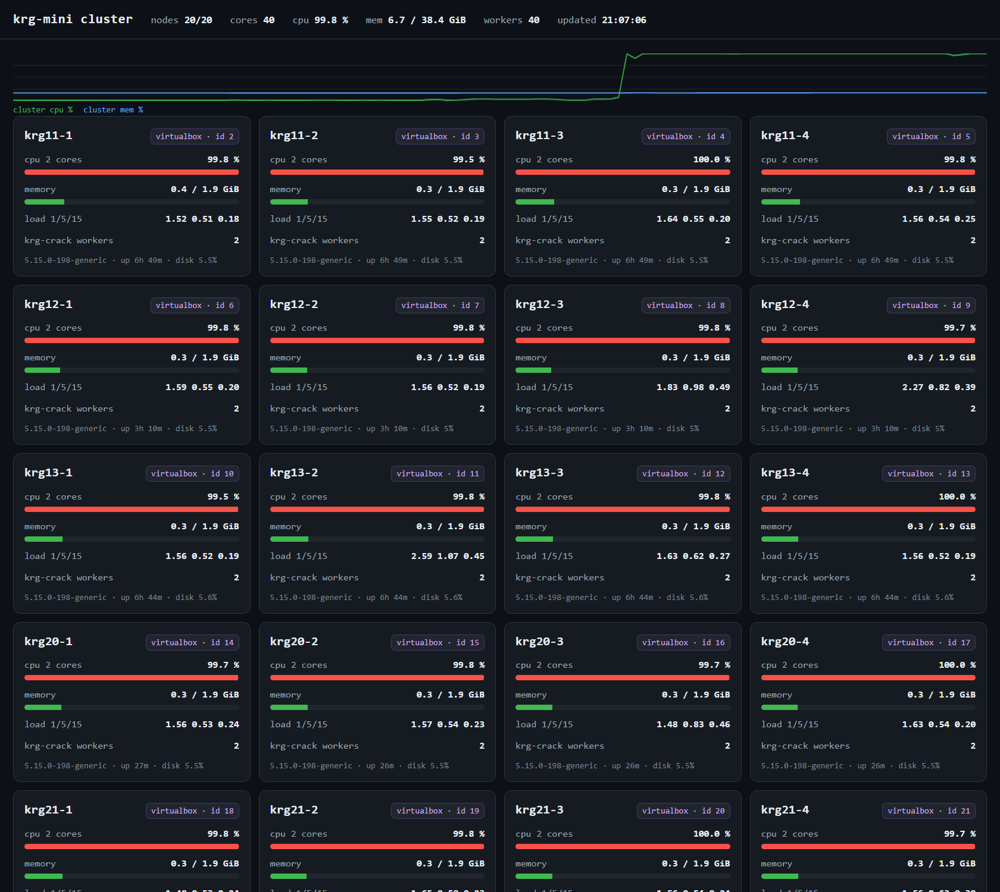
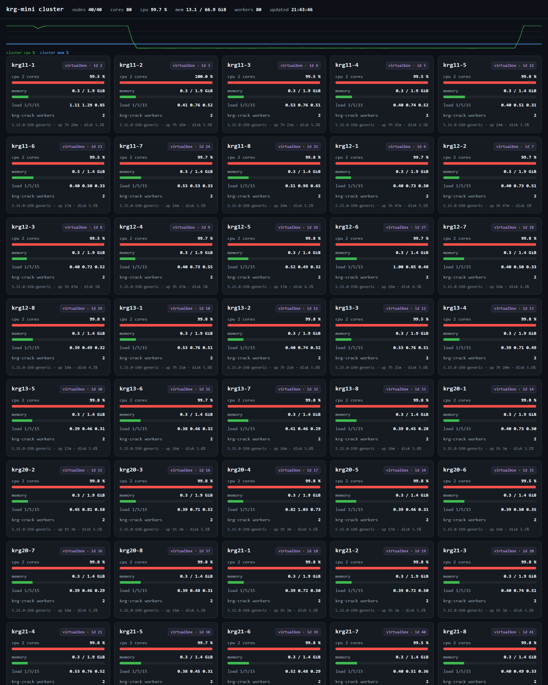

# krg-mini — a minimal single system image on Linux

> **AI-assisted project.** Built in pair-programming with an AI coding agent
> (OpenAI Codex) and a human maintainer; every change was compiled, installed and
> measured on real machines. See [AI disclosure](#ai-disclosure).

## At a glance — cluster vs one box (measured 2026-10-27)

| setup | compute it uses | throughput | per unit |
|---|---|---|---|
| one box, 20 processes | 20 procs on 24 cores / 48 threads | 16.3 MHash/s | **0.813** per process |
| one box, 40 processes | 40 procs, same box | 19.0 MHash/s | **0.474** per process |
| one box, 48 processes (one per thread, packed) | 48 procs, same box | 17.5 MHash/s | **0.364** per process |
| **20-node cluster** | **40 vCPU** (5 hosts x 4 VMs) | **25.4 MHash/s** | **0.635** per vCPU |
| **40-node cluster** | **80 vCPU** (5 hosts x 8 VMs) | **49.2 MHash/s** | **0.615** per vCPU |

Same workload in every row: SHA-256 preimage search. Cluster rows are a fixed 2 G-hash
budget, median of 3; the one-box rows are the same inner loop with no cluster layer at
all. **The cluster is 2.63x that box at 40 processes and 2.81x at 48** — the gain is not
anything being shared, it is not being squeezed onto 24 physical cores. Details:
[docs/BENCHMARKS.md](docs/BENCHMARKS.md) ·
[20-node report](docs/REPORT_2026-10-27_20nodes.md) ·
[40-node report](docs/REPORT_2026-10-27_40nodes.md)

Kerrighed was a Single System Image (SSI) cluster: many Linux boxes that look like
one machine — one process table, one memory, one scheduler, live process migration.
It died with 2.6.30. **krg-mini** keeps the idea and throws away almost everything
else: 962 lines across two kernel modules (`krg_taskview.c` 530, `krg_dsm.c` 432)
plus six userspace tools (2510 lines), built against a stock Ubuntu 22.04 kernel,
no patch required.

An SSI is four things at once. Here is where this project stands — no more, no less
(full statement, with the code each row is checked against: [docs/WHAT-IS-ONE-MACHINE.md](docs/WHAT-IS-ONE-MACHINE.md)):

| property | status |
|---|---|
| one process space — `ps` / `kill` on any node reaches every task | **yes**: `/dev/krgview` exports each node's table, merged in userspace, global pid = `node_id << 24 \| pid` |
| a task can be created on any node | **partial**: `SPAWN` starts a process on another node, but it is not part of the caller's process tree |
| one file system — same path, same bytes everywhere | **no**: `krgsh ls` runs `ls` per node and prints the results side by side |
| one memory — an address range visible from every node | **partial**: `/dev/krgdsm` named segments, pages cost memory only when touched, a reader can pull into a bounded cache and read a segment far bigger than its own RAM — but through read/write calls, not pointers, and the far side is read-only |

**Target release khz v0.1**: properties 1–3 above — one process space, one CPU, one
memory — each with an acceptance test anyone can rerun. One file system is explicitly
out of scope for v0.1. Criteria: [docs/WHAT-IS-ONE-MACHINE.md](docs/WHAT-IS-ONE-MACHINE.md).

## TODO

- [x] one process table across nodes (`/dev/krgview`, global pid)
- [x] create / kill a task on another node (`SPAWN` / `KILL`)
- [x] cluster shell: `free` / `top` merged across every node
- [x] live status board (`krg-top`, one HTML page)
- [ ] **one `/krg`** — a shared tree; `ls` and `bash` touch the same bytes on every node (NFS first)
- [ ] **single-shell cross-node jobs** — the command runs once, a pipeline's stages land on different machines, `Ctrl-C` stops the whole job, exit codes come back
- [ ] **remote fork** — the child lands on another node and keeps the parent's fds / pipes / sockets (not re-opened by path)
- [ ] **identity vs location** — `node_id << 24 | pid` is a birth identity only; where it runs now needs a lookup
- [x] **kernel initial placement for `SPAWN`** — no target given, the kernel picks the idlest node and reserves it (**khz v0.1**)
- [ ] **placement for ordinary `fork`/`exec`, and rebalance** — only `SPAWN` goes through the kernel's policy today; a running task is never moved
- [x] **paged DSM** — named segments in `/dev/krgdsm`: lazy pages, `DSMGET` in 64-page batches, bounded read cache (**khz v0.1**)
- [ ] **DSM as memory** — a shared address space with faults and write ownership, instead of explicit read/write calls (one home per segment today)
- [x] scale out to 5 physical hosts + 20 VMs (4 VMs per host, physical boxes are hosts only)
The next three steps, in order: a shared `/krg` (NFS first, so paths and bytes
agree), then a process tree that spans nodes (remote fork with fd/pipe objects
forwarded), then a paged DSM. Until the last one lands, this is honest to call a
*partial* SSI.

What actually works today:

| capability | how |
|---|---|
| one process table across nodes | `/dev/krgview` exports each node's task list; `krgtool show` merges them. Every task carries a **global pid** = `node_id << 24 \| pid`. |
| create / kill a task on another node | write `SPAWN <cmd>` or `KILL <gpid>` to `/dev/krgview`; the kernel uses `call_usermodehelper` / `kill_pid` |
| placement in the kernel | `SPAWN` with no target: the module keeps a per-node load table (`LOAD <node> <runq> <seq>`, stale seq rejected), picks min `runq + reservations`, breaks ties round-robin, and reserves the pick (`KRGV_IOC_PLACE` / `_RELEASE`). `krgtool spawn --auto` feeds the numbers and forwards to whatever the kernel chose — it never re-picks. |
| cluster shell with built-in commands | `krgsh` — `free`, `top`, `ls`, `bash` run on every node and come back merged |
| load-aware placement + retry | `krg-pi` asks every node for its run queue, places shards on the least loaded ones, and re-runs shards whose worker died |
| throughput workload | `krg-crack` — SHA-256 preimage search; workers pull 1M-nonce chunks from a queue, the winner is re-hashed locally |
| paged shared memory | `krgdsm` + `/dev/krgdsm` — a segment is a name plus page slots; `alloc` reserves slots, `write` allocates the page, `seal` freezes, `DSMGET` pulls pages from the home node 64 at a time, `--cache N` caps the reader at N pages and evicts the oldest |
| live status board | `krg-top` — one HTML page with every node's CPU, memory, load, kernel and worker count; reads through `krgtool exec` so unreachable nodes show as unreachable |

What is **not** here: process migration, a shared address space (the DSM is an explicit
read/write API over named segments, read-only on the far side), a distributed
filesystem, a run queue shared between nodes. Those are the hard 90% of Kerrighed.

## Repository layout

```
module/krg_taskview.c   the whole kernel side: /dev/krgview (read table, write SPAWN/KILL)
module/krg_dsm.c        paged shared segments: /dev/krgdsm (alloc/write/read/seal/info)
user/krgtool.c          local/ serve/ show/ spawn/ kill/ load/ mem/ exec
user/krgdsm.py          alloc / fill / seal / fetch / stream a named segment
user/krgsh.py           cluster shell: free / top / ls / bash (+ nodes, show)
user/krg-pi.py          distributed pi to N digits, used as the SSI demo workload
user/krg-crack.py       SHA-256 preimage search, used to measure cluster throughput
user/krg-top.py         live status board (HTTP + one HTML page, stdlib only)
deploy/install.sh       build + install on one node
deploy/krg-mini.service systemd unit (modprobe + krgtool serve 7700)
deploy/krg-nodes.list.example
docs/DESIGN.md          data structures, wire protocol, coordinator logic
docs/WHAT-IS-ONE-MACHINE.md  the four SSI properties, one by one, with what is real and what is only displayed
docs/BENCHMARKS.md      measured numbers on 13-, 15-, 20- and 40-node setups + how to reproduce
docs/REPORT_2026-10-27_20nodes.md  the 20-node round as a standalone report (method, numbers, limits, raw log)
docs/REPORT_2026-10-27_40nodes.md  the 40-node round + the 20 -> 40 scaling comparison
```

## Requirements

- Linux with matching kernel headers (`linux-headers-$(uname -r)`), gcc
- Python 3.8+ on every node that runs `krgsh` / `krg-pi`
- A trusted network. **`krgtool serve` has no authentication** — it will run any
  shell command it is asked to run. Keep port 7700 on a private network.

## Quick start (two boxes)

```sh
# on every node: pick a unique node_id (1..255) and install
sudo ./deploy/install.sh 1          # head node
sudo ./deploy/install.sh 2          # worker

# on every node: same cluster list
sudo cp deploy/krg-nodes.list.example /etc/krg-nodes.list   # then edit
```

Verify:

```sh
krgsh -c 'bash hostname; uname -r'   # one block per node
krgsh -c top -n 10                   # merged process table
krgsh -c free                        # cluster memory
krgsh -c 'ls -l /var/log'            # same path on every node

# shared memory between two nodes: 256 MiB of data, 256 KiB of cache
krgdsm alloc pool 65536                  # on the home node: slots only
krgdsm fillrange pool 0 65536            # stamp all 65536 pages
krgdsm seal pool
krgdsm alloc pool 65536 --cache 64       # on the reader: 64 pages is all it keeps
krgdsm stream pool 0 65535 10.0.2.2:7801 --verify
```

`krgsh` also runs interactively, and reads commands from stdin, so it can be
scripted:

```sh
printf 'free\ntop -n 5\n' | krgsh
```

Anything that is not a built-in goes through `bash`, exactly like
`krgsh -c 'bash <command>'`.

## The demo workload

```sh
krg-pi --digits 100        # 13 nodes, self-checked against Machin's formula
krg-pi --digits 50000
```

Each shard is a Chudnovsky term range; the coordinator asks each node for its
runnable-task count first, sorts nodes by load, and retries any shard whose worker
does not answer within the deadline (3 rounds max). The result is verified against
an independent Machin computation, so a wrong answer cannot pass silently.

## Measured (2026-10-27, 13 nodes)

| workload | 13 nodes | one VM (1 shard) | one VM forced to run 13 shards |
|---|---|---|---|
| pi(100), 5 runs, median | **307 ms** | 263 ms | 653 ms |
| pi(50000), 1 run | 7915 ms | 7090 ms | 11701 ms |

pi(100) is 0.1–0.2 ms of actual arithmetic, so those numbers are coordination
overhead, not speed-up. At 50000 digits the cluster does not beat a single VM
either: 4.8 s of every run is the serial Machin self-check and 2.3 s is the
start-up term of the last shard. See `docs/BENCHMARKS.md` for the breakdown;
the sharding scheme is the obvious thing to fix.

## Measured throughput (2026-10-27, 15 / 20 / 40 nodes)

`pi` is a latency workload and loses to one VM, so the second workload is pure
throughput: `krg-crack` searches a SHA-256 hash prefix of 12 hex zeros, in
1,000,000-nonce chunks pulled from the coordinator, with `--budget` pinning the
amount of work so a lucky hit cannot flatter the number.

| rig | threads | work | wall | rate |
|---|---|---|---|---|
| one VM (2 vCPU) | 2 | 60 M | 45.6 s | 1.3 MHash/s |
| 12 VMs over 3 hosts | 24 | 601 M | 40.3 s | 14.9 MHash/s |
| one 48-thread server | 48 | 1.00 G | 69.1 s | 14.5 MHash/s |
| **15-node cluster (3 servers + 12 VMs)** | **168** | **2.00 G** | **46.3 s** | **43.3 MHash/s** |
| **20-node cluster (5 hosts x 4 VMs, VMs only)** | **40** | **2.00 G** | **78.7 s** | **25.4 MHash/s** |
| **40-node cluster (5 hosts x 8 VMs, VMs only)** | **80** | **2.00 G** | **40.7 s** | **49.2 MHash/s** |

- The cluster scales: 43.3 MHash/s is **2.4x** what one of those servers does with
  no cluster layer at all (18.3 MHash/s, same loop in bare `fork()`+`hashlib`), and
  **33x** a single 2-vCPU VM.
- The win is core count, not the SSI. Per thread the cluster gets 0.26 MHash/s
  against 0.38 on bare metal — about 68% — because the coordinator is one Python
  process doing a socket round trip per chunk, and the head node also hosts four VMs.
- 24 VM threads land on the same 14.9–14.5 MHash/s as one 48-thread box: those 48
  are 24 physical cores with SMT, and CPython's SHA-256 gains almost nothing from
  the sibling thread.
- Fanning out 168 workers across 15 nodes costs 4.9 s of the 46 s run.
- **Where the coordinator runs matters more than its clock speed.** The same 2 G
  of work takes 43.7 MHash/s (median of 3) when the coordinator is one of the
  worker nodes and also hosts four VMs, and 49.2 MHash/s (+12.6%) when it is a
  separate ARM box that hashes nothing — fan-out drops from ~4.9 s to ~2 s. What
  the coordinator needs is not being preempted, not a fast core.

- **On the 20-node rig (40 vCPU, no host oversubscribed) the cluster reaches
  25.4 MHash/s, 1.56x a single box running 20 bare processes (16.3) and 1.34x one
  running 40 (19.0), at 78% of bare-metal per-thread rate (0.635 vs 0.813).** Fanning
  out 40 workers there costs 0.4-0.6 s out of a 78 s run. The 15-node 168-thread
  number is not comparable to it: per thread that rig got 0.29, this one 0.635.

- **Doubling the node count on the same five hosts buys 1.94x, not 2.00x.** From
  40 vCPU to 80 vCPU: 78.78 s -> 40.67 s for the same 2 G of hashes, i.e. 25.4 ->
  49.2 MHash/s, and per-vCPU 0.635 -> 0.615 (**96.9 % retained, -3.1 %**). Fan-out
  goes from 0.5-0.8 % of the run to 1.3-2.4 %; it is still the cheapest thing in
  the pipeline.
- **Where the win actually comes from.** On the same day, one 48-thread box does
  18.7 MHash/s with 40 processes (0.468 each) and 17.5 with 48 (0.364 each) - past
  one process per physical core, total throughput *falls*. The 40-node cluster
  keeps 0.615 per vCPU, so it is 2.63x that box at 40 processes and 2.81x at 48,
  and 1.69x per vCPU against the packed box. The gain is **not being squeezed onto
  one socket pair**, not SSI magic: the same conclusion the 20-node round reached,
  now at twice the size.

| | 20 nodes | 40 nodes | ratio |
|---|---|---|---|
| vCPU | 40 | 80 | 2.00x |
| wall clock, 2 G hashes | 78.78 s | 40.67 s | 1.94x faster |
| throughput | 25.4 MHash/s | 49.2 MHash/s | **1.94x** |
| per vCPU | 0.635 | 0.615 | **0.969x** |
| fan-out share of runtime | 0.5-0.8 % | 1.3-2.4 % | |




Full environment, per-node numbers and the exact commands are in
`docs/BENCHMARKS.md`; the two benchmark rounds have their own write-ups,
`docs/REPORT_2026-10-27_20nodes.md` and `docs/REPORT_2026-10-27_40nodes.md`.

## Measured: shared memory (2026-10-27)

Two 2 GiB VMs (`krg11-1` = node 2, home; `krg11-2` = node 3, reader), segment
`pool` = 65 536 pages = **256 MiB**.

| | result |
|---|---|
| home: slots reserved by `alloc` | 65 536, no page memory taken |
| home: after writing all pages | `used` 220 MB -> 477 MB (+257 MB = 256 MiB of pages) |
| reader: cache | 64 pages = 256 KiB |
| reader: reads all 256 MiB, three runs | 32.2 / 31.3 / 35.5 MiB/s, 110-125 us/page, **0 content mismatches** |
| reader: peak resident | **64 pages = 0.2 MiB**; `used` 186 MB -> 184 MB (no growth) |

The reader used 256 KiB to read 256 MiB. That is the difference between "the cluster
reports one big memory" and "a node can use memory that lives on another node".

Batch size matters more than bandwidth. On a 256-page segment, one request per page
cost 1550-1970 us/page (2.0-2.5 MiB/s); 64 pages per request cost 146-150 us/page
(26.1-26.8 MiB/s) between the same two nodes.

Reading a page that is not local returns `ENODATA`, not zeros. Writing to a cache
segment returns `EPERM` - a reader's copies are read-only, so the home node cannot lose
data it owns.

## Status

A teaching prototype. It is honest about what it does, small enough to read in an
afternoon, and a reasonable starting point if you want to grow one SSI feature at
a time on a modern kernel.

## 中文简介

**一眼看结果（2026-10-27 实测，同一个负载：SHA-256 原像搜索）**

| 组别 | 用了多少算力 | 吞吐 | 每份 |
|---|---|---|---|
| 单机 20 进程 | 20 进程 / 24 核 48 线程 | 16.3 MHash/s | **0.813** /进程 |
| 单机 40 进程 | 40 进程 / 同一台机器 | 19.0 MHash/s | **0.474** /进程 |
| 单机 48 进程（一线程一进程，塞满） | 48 进程 / 同一台机器 | 17.5 MHash/s | **0.364** /进程 |
| **20 节点集群** | **40 vCPU**（5 宿主 × 4 VM） | **25.4 MHash/s** | **0.635** /vCPU |
| **40 节点集群** | **80 vCPU**（5 宿主 × 8 VM） | **49.2 MHash/s** | **0.615** /vCPU |

集群行是固定 2 G 哈希工作量、3 轮取中位；单机行是同一套内层循环、完全没有集群层。
**集群是那台机器跑 40 进程的 2.63 倍、跑 48 进程的 2.81 倍** —— 赢的不是"共享了什么"，
而是**没被挤在 24 个物理核上**。细节见 [docs/BENCHMARKS.md](docs/BENCHMARKS.md)、
[20 节点报告](docs/REPORT_2026-10-27_20nodes.md)、[40 节点报告](docs/REPORT_2026-10-27_40nodes.md)。

**krg-mini 是把 Kerrighed 的"单系统映像（SSI）"思路做到最小的一份实现。**
Kerrighed 是 Linux 2.6 时代的 SSI 集群 —— 一堆机器看起来像一台：一张进程表、一份内存、
一个调度器，进程还能在线迁移。它随 2.6.30 一起停在了过去。krg-mini 只留下骨架：
**两个内核模块共 962 行（`krg_taskview.c` 530 + `krg_dsm.c` 432）+ 六个用户态工具 2510 行，
不用打内核补丁**，在 Ubuntu 22.04 的原版内核上直接编译加载。

| 已经能做到 | 怎么做的 |
|---|---|
| 一张跨节点的进程表 | 内核模块导出 `/dev/krgview`，每台机器一张表，用户态合并；每个进程有**全局 pid** = `节点号 << 24 \| pid` |
| 在别的节点上建 / 杀进程 | 往 `/dev/krgview` 写 `SPAWN <命令>` 或 `KILL <全局pid>`，由**内核**用 `call_usermodehelper` / `kill_pid` 执行 |
| 集群 shell | `krgsh`：`free` / `top` / `ls` / `bash` 一条命令扇出到所有节点，结果按节点分块显示 |
| 按负载分配 + 失败重试 | `krg-pi`：先问每台机器的运行队列长度，把分片放到最闲的节点，超时没回来的分片换节点重算（最多 3 轮） |
| 吞吐型负载 | `krg-crack`：SHA-256 原像搜索。worker 从队列里按 100 万个 nonce 一块地领，命中的那块在本地重算一遍再报，防止误报 |
| 实时状态面板 | `krg-top`：一个 HTML 页面显示每个节点的 CPU / 内存 / 负载 / 内核 / worker 数；数据也是走 `krgtool exec` 取的，连不上的节点直接标成连不上 |

SSI 是四件事凑齐才叫"一台机器"。这里照实标出到哪一步：

| SSI 的构成 | 现在的状态 |
|---|---|
| 单一进程空间（任意节点 `ps` / `kill` 都能碰到所有进程） | **有**：`/dev/krgview` 导出各节点进程表，用户态合并；全局 pid = `节点号 << 24 \| pid` |
| 任务可以在任意节点上创建 | **部分**：`SPAWN` 能在别的节点起进程，但它不是调用者那棵进程树的一部分 |
| 单一文件系统（同一路径、同一份数据） | **没有**：`krgsh ls` 是每台各列一遍再拼起来 |
| 单一内存（一段地址空间多节点可见） | **没有** |

下一个版本的名称定为 **khz v0.1**：上面第 1–3 条（单一进程空间 / 一块 CPU / 一大片内存）都要落地，
每条都带一个别人能重跑的验收测试；**单一文件系统明确不在 v0.1 范围内**。
逐条判定依据与验收标准写在 [docs/WHAT-IS-ONE-MACHINE.md](docs/WHAT-IS-ONE-MACHINE.md)。

## 待办

- [x] 跨节点进程表（`/dev/krgview`，全局 pid）
- [x] 在别的节点建 / 杀进程（`SPAWN` / `KILL`）
- [x] 集群 shell：`free` / `top` 合并整个集群
- [x] 实时状态面板（`krg-top`，一页 HTML）
- [ ] **单一 `/krg`** —— 同一棵树，`ls` / `bash` 在每台机器碰到的是同一份字节（先上 NFS）
- [ ] **单 shell 的跨节点作业** —— 一条命令只执行一次，管道各段落在不同机器上，`Ctrl-C` 能停整条作业，退出码能回来
- [ ] **远程 fork** —— 子进程落到别的节点，并且保留父进程的 fd / 管道 / socket（不是按路径重新打开）
- [ ] **身份与位置分开** —— `节点号 << 24 | pid` 只当出生身份，跑在哪要另查
- [x] **`SPAWN` 的内核初始放置** —— 不指定节点时，由内核挑最闲的节点并做预留（**khz v0.1**）
- [ ] **普通 `fork` / `exec` 的放置与再平衡** —— 现在只有 `SPAWN` 走内核策略，跑起来的进程不会迁移
- [x] **按页共享内存** —— `/dev/krgdsm` 命名段：页按需才占内存，`DSMGET` 一次拉 64 页，读端缓存有上限（**khz v0.1**）
- [ ] **当成内存用** —— 共享地址空间 + 缺页 + 写归属，而不是显式 read/write 调用；现在一个段只有一个 home
- [x] 扩到 5 台物理机 + 20 台虚拟机（2026-10-27：5 台宿主各跑 4 台 VM = 20 个节点，物理机只当宿主）
接下来三步：先 `/krg` 共享（先上 NFS，让路径和数据一致），再做跨节点的进程树（远程 fork，
继承的 fd / 管道 / socket 这些对象要自己转发，不能在远端按路径重新 open），最后才是按页拉取的 DSM。
第三块落地之前，它只能叫**部分 SSI**。
**没做的**（也就是 Kerrighed 真正难的那 90%）：进程迁移、共享地址空间（共享内存是按页的显式读写接口，
远端只读，不是把指针指过去）、共享文件系统、跨节点共用一条运行队列。
这里的 `ls` 只是"同一个路径在每台机器各列一遍"，因为节点之间并没有共享文件系统。

**一大片内存，实测（2026-10-27，两台 2 GiB 虚拟机）**：段 = 65 536 页 = 256 MiB，home 在 node 2。
home 只占槽位、写一页才占一页，写满后 `used` 220 → 477 MB（+257 MB）。读端 `--cache 64`（256 KiB），
把 256 MiB 全文读三遍：32.2 / 31.3 / 35.5 MiB/s，110–125 µs/页，内容零错，**峰值驻留 64 页 = 0.2 MiB**，
读端 `used` 186 → 184 MB（没长）。**用 256 KiB 读了 256 MiB** —— 这才叫"用上了别人的内存"。
读到不在本地的页返回 `ENODATA`（不是零），往缓存段写返回 `EPERM`（读端副本只读，home 不会被覆盖）。
批量比网络更值钱：同一个 256 页的段，一页一次请求 1550–1970 µs/页（2.0–2.5 MiB/s），
一次 64 页 146–150 µs/页（26.1–26.8 MiB/s）。

实测（2026-10-27，13 个节点 = 1 台物理机 + 12 台虚拟机，Ubuntu 22.04 / 内核 5.15）：
`krgsh` 一条命令汇总 13 台机器的进程表、内存、目录；`krg-pi --digits 100` 13/13 节点应答、
结果用独立的 Machin 公式逐位校验通过，中位 307 ms；`--digits 50000` 用时 7.9 s。
**100 位这个量级本来只有 0.1–0.2 ms 的算术量，307 ms 全是协调开销** ——
数字怎么看、怎么复现，都写在 `docs/BENCHMARKS.md` 里，没有粉饰。

**吞吐型负载**（`krg-crack`：SHA-256 原像搜索，用 `--zeros 12 --budget` 定死工作量）：
单台 2 vCPU 虚拟机 1.3、12 台虚拟机（24 vCPU）14.9、单台 48 线程物理机 14.5，
**15 节点集群（3 台物理机 + 12 台虚拟机，168 个 worker）43.3 MHash/s** ——
是单台物理机**裸机**（18.3）的 2.4 倍、单虚拟机的 33 倍。
但每线程只有 0.26（裸机 0.38，约 68%）：**扩出来的收益来自核数，不是来自 SSI**，
协调端是单个 Python 进程，168 个 worker 的分发本身要 4.9 s。

**协调端放在哪儿，比它跑多快更重要**：同一份 2 G 工作量，协调端和 worker 挤在同一台机器上
（而且那台机器还扛着 4 台虚拟机）是中位 43.7 MHash/s；挪到一台**不参与计算**的 ARM 板子上是
**49.2 MHash/s（+12.6%）**，分发开销从约 4.9 s 降到约 2 s。协调端一个哈希都不算，
它要的是"不被打断"，不是单核快。

**20 个节点（5 台宿主 × 4 台 VM，物理机只当宿主，共 40 vCPU；协调端在那块 ARM 板子上）**：
同一份 2 G 工作量跑 3 轮，78.23 / 78.78 / 78.71 s，中位 **25.4 MHash/s**（每线程 0.635）。
同样的循环去掉集群层、在单台物理机上跑 20 个进程是 16.3 MHash/s（每进程 0.813）——
**集群是单机 20 核的 1.56 倍**；单机跑 40 个进程是 19.0（每进程 0.474，被 SMT 挤），集群是它的 1.34 倍。
每线程能到裸机的 78%，差的约五分之一是协调端（一个 Python 进程、每 100 万哈希一次 socket 往返）；
40 个 worker 的分发只要 0.4–0.6 s，占 78 s 的不到 1%。
注意 15 节点那组 49.2 是 168 个线程、而且宿主被压过头，不能和这里的 40 线程直接比（每线程 0.29 对 0.635）。

**扩容到 40 个节点（同一批 5 台宿主，每台 8 台 VM，2 vCPU / 1.5 GiB，共 80 vCPU）**，
同样的 2 G 工作量跑 3 轮：40.77 / 40.67 / 40.45 s，中位 **49.2 MHash/s**（每 vCPU 0.615）。

| | 20 节点 | 40 节点 | 比值 |
|---|---|---|---|
| vCPU | 40 | 80 | 2.00 倍 |
| 墙钟（2 G 哈希） | 78.78 s | 40.67 s | 快 1.94 倍 |
| 吞吐 | 25.4 MHash/s | **49.2 MHash/s** | **1.94 倍** |
| 每 vCPU | 0.635 | **0.615** | **96.9 %（掉 3.1 %）** |
| 分发开销占墙钟 | 0.5–0.8 % | 1.3–2.4 % | |

同一天在同一台 48 线程物理机上补测的裸机对照：40 进程 18.7 MHash/s（每进程 0.468）、
48 进程 17.5（每进程 0.364，**塞满反而比 40 进程更慢**）。所以 40 节点集群是这台机器
40 进程的 **2.63 倍**、48 进程的 **2.81 倍**，每 vCPU 是塞满状态下的 **1.69 倍**。
结论和 20 节点那轮一致：**赢在"不用挤同一对 CPU"，不是赢在 SSI**。

压力测试中的状态面板（`krg-top`，run 2 现场）：


**实时状态面板**（`krg-top`）：一个 HTML 页面显示每台机器的 CPU、内存、负载、内核和 worker 数，
走 `krgtool exec` 取数，连不上的节点就照实显示连不上。

**安全提醒**：`krgtool serve` 没有任何认证，能执行任意 shell 命令，只能跑在可信内网。

用法、协议、数据结构见 `README.md` 上半部分和 `docs/DESIGN.md`。

## AI disclosure

本项目是**人和 AI 结对做出来的**，这里把话说清楚：

- **AI 做的**：起草内核模块（`krg_taskview.c`）、`krgtool`、`krgsh`、`krg-pi` 的代码与文档，
  按人的要求做实验、跑测量、写报告。
- **人做的**：定方向与边界（从 Kerrighed 里取哪一小块、不做什么）、审阅每一笔改动、
  在真机上编译安装并验证、决定什么算"完成"。
- **"验证过"是什么意思**：每个里程碑都在目标内核上编译、装到 13 台节点上、用真实输出核对 ——
  例如合并进程表、跨节点建/杀进程、13 节点算 π 并用独立的 Machin 公式逐位比对。
  没有"应该能跑"这种结论。
- **边界**：这是一个原型，不是生产系统；AI 写的代码同样会有错，欢迎按普通开源项目的标准审视它。

*English:* this project was written in pair-programming with an AI coding agent
(OpenAI Codex). The AI drafted the kernel module, the userspace tools and the
docs; the human set the scope, reviewed every change, and built, installed and
measured everything on real hardware. "Verified" here always means an actual build
plus actual output on the 13-node cluster (merged process table, cross-node
spawn/kill, pi to N digits checked bit-for-bit against Machin's formula) — never
"should work". It is a prototype; review it like any other open source code.
## License

GPL-2.0. The kernel module declares `MODULE_LICENSE("GPL")`; everything is under
the same terms (see `LICENSE`).
