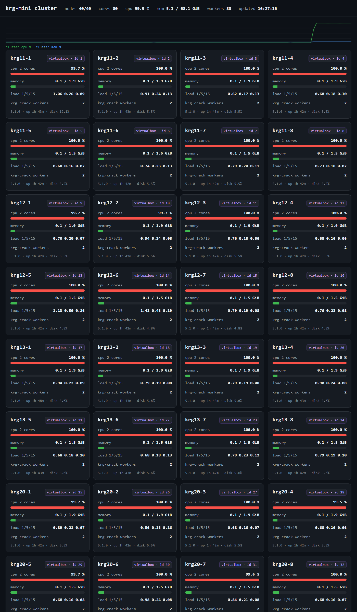

# Report — same 40 nodes, on a kernel we compile ourselves (5.15 -> 5.1): what did it cost

**Date:** 2026-10-28 · **Rig:** the same 40 VirtualBox guests on the same 5 physical hosts as
`REPORT_2026-10-27_40nodes.md` · **Status:** measured

Yesterday's 40-node number (49.2 MHash/s) was taken on the distro kernel, 5.15.0-198. Since then
all 40 guests were rebuilt on **our own kernel, 5.1.0 #1 SMP** — 5.1 being the last tree upstream
Kerrighed ever supported, and the tree this project is migrating onto. Nothing else changed.

So this round asks exactly one question: **does running on our kernel cost throughput?**

Short answer: no. Median went 49.2 -> 49.0 MHash/s, i.e. **0.996x** — inside the noise of the
runs themselves (today's five runs span 48.8–49.4).

---

## 1. What changed

| item | 2026-10-27 | this run |
|---|---|---|
| kernel on every guest | 5.15.0-198-generic (Ubuntu 22.04 stock) | **5.1.0 #1 SMP** (built here, `vmlinuz-5.1.0-krg`) |
| how it boots | distro initramfs | **all built-in, no initramfs** |
| build flags worth knowing | distro default (`RETPOLINE=y`) | `RETPOLINE=n`, modules off except what we need |
| krg modules | in-tree-ish `/lib/modules/.../kernel` | **out-of-tree**, `insmod` by full path from `krgcheck.service` |
| guests per host / size | 8 x (2 vCPU / 1.5 GiB) | same |
| total | 40 nodes, 80 vCPU | same |
| workload, budget, workers/node | `krg-crack --zeros 12 --budget 2000000000 --workers-per-node 2` | same |
| coordinator | separate ARM board, not a node | same |

The user space (Ubuntu 22.04, python 3.10, the same `krg-crack.py`) is byte-identical between the
two rounds. The only variable is the kernel underneath it.

## 2. Method

Identical to `REPORT_2026-10-27_40nodes.md` §2-3: SHA-256 nonce search requiring 12 leading hex
zeros, 1,000,000-nonce chunks pulled from the coordinator queue, fixed 2 G-hash budget so every run
does the same amount of work, one 2-per-node worker pair (one per vCPU). Timings are the
coordinator's own wall clock from first chunk to last.

## 3. Results

### Today, 5.1.0 (five runs)

| run | start (CST) | hashes counted | wall | rate |
|---|---|---|---|---|
| 1 | 15:47:51 | 2,002,000,000 | 40.86 s | 49.0 MHash/s |
| 2 | 15:48:32 | 2,000,000,000 | 41.00 s | 48.8 MHash/s |
| 3 | 15:49:13 | 2,001,000,000 | 40.89 s | 48.9 MHash/s |
| 4 | 15:52:17 | 2,004,000,000 | 40.60 s | 49.4 MHash/s |
| 5 | 16:26:49 | 2,000,000,000 | 40.67 s | 49.2 MHash/s |

**Median 49.0 MHash/s over 80 vCPU = 0.613 MHash/s per vCPU.**

Every run reported `workers 80 on 40 nodes`, no `unreachable`, no `no progress`. Run 5 is the one
whose dashboard screenshot is in §4 — it was taken 27 s into a 40.7 s run, so the numbers and the
picture are the same run.

### Yesterday, 5.15.0 (from `REPORT_2026-10-27_40nodes.md` §3)

| run | hashes counted | wall | rate |
|---|---|---|---|
| 1 | 2,003,000,000 | 40.77 s | 49.1 MHash/s |
| 2 | 2,002,000,000 | 40.67 s | 49.2 MHash/s |
| 3 | 2,001,000,000 | 40.45 s | 49.5 MHash/s |

**Median 49.2 MHash/s = 0.615 MHash/s per vCPU.**

## 4. Kernel swap, side by side

| | 5.15.0 stock | **5.1.0 ours** | ratio |
|---|---|---|---|
| median throughput | 49.2 MHash/s | **49.0 MHash/s** | **0.996x** |
| median wall, 2 G hashes | 40.67 s | 40.86 s | 1.005x |
| per vCPU | 0.615 | **0.613** | 0.997x |
| spread across runs | 49.1–49.5 (0.8 %) | 48.8–49.4 (1.2 %) | — |
| nodes answering | 40/40 | 40/40 | — |

The 0.4 % difference is smaller than the spread within either day, so this is not a slowdown to
explain — it is the same number twice.

## 5. The dashboard, under load



Taken at 16:27:16 CST, 27 s into run 5 (`updated 16:27:16`, `workers 80`, `cpu 99.9 %`). Every one
of the 40 cards reports `cpu 2 cores 99.7–100.0 %`, `krg-crack workers 2`, and `5.1.0 · up 43m` —
i.e. the load really is on the kernel we swapped in, not on a leftover 5.15 guest.

## 6. Single machine, same loop (baseline from 2026-10-27, **not** re-measured today)

| setup | processes | rate | per process |
|---|---|---|---|
| `nd20`, 24 cores / 48 threads | 40 | 19.0 MHash/s | 0.474 |
| `nd20`, same box | 48 | 17.5 MHash/s | 0.364 |

Against the 5.1 cluster: 49.0 / 19.0 = **2.58x** the same box at 40 processes.

These rows are the 2026-10-27 measurement (`REPORT_2026-10-27_40nodes.md` §5, plus the 20-process
row from the 20-node report). They were **not** re-run on 5.1 — swapping the kernel cannot change a
baseline that has no kernel of ours in it, but the wall clock and the host load do matter, so treat
the 2.58x as "same order, from the previous day", not as a same-hour A/B.

## 7. One run set that was wrong, and why it is in this report

The first attempt today used `--zeros 7` instead of the 12 used on 2026-10-27. With 7 zeros the
search finds a hit in ~8 s, the pool drains early and the "rate" it prints is a startup-contaminated
46.1 / 42.4 / 43.4 MHash/s — not a steady-state number. Those three runs are discarded, not averaged
in. The tell is in the log: `verify OK (leading 7 hex zeros)` and a wall time of 8 s where a 2 G
budget should take 41 s.

## 8. Two nodes, same kernel (sanity check on the small end)

| run | hashes counted | wall | rate | per vCPU |
|---|---|---|---|---|
| 2 nodes / 4 workers | 100,000,000 | 42.64 s | 2.3 MHash/s | 0.586 |

Same binary, same chunk size, budget 100 M instead of 2 G. Per-vCPU is 4.4 % below the 40-node
figure — what you would expect from having only 4 processes to hide latency with, rather than from
anything the cluster does differently.

## 9. What this does not say

- It does not say 5.1 is faster. It says it is not slower on this workload.
- It does not measure kernel-side effects at all: this workload is user-space SHA-256 pushed through
  `krgtool`; no syscall-heavy, fork-heavy or memory-heavy workload was run on 5.1.
- `top` / `ps` / `free` cluster view is **our** `krgsys` / `krgtool`, not the stock tools. The stock
  ones on a node still only see that node; the `/proc` interfaces are not implemented yet.
- Only one kernel config was tested (`RETPOLINE=n`, all built-in). A differently configured 5.1
  would not be covered by this table.

## 10. Reproduce

```bash
# coordinator (nd13), not a node
cd /root/krg51/krg/user
KRGTOOL=/root/krg51/krg/user/krgtool-static python3 krg-crack.py \
  --zeros 12 --nodes /root/krg51/deploy_pkg/nodes.list \
  --workers-per-node 2 --budget 2000000000 --port 9911

# 2-node sample
head -2 /root/krg51/deploy_pkg/nodes.list > /root/krg51/two.list
KRGTOOL=/root/krg51/krg/user/krgtool-static python3 krg-crack.py \
  --zeros 12 --nodes /root/krg51/two.list \
  --workers-per-node 2 --budget 100000000 --port 9912
```

Dashboard for the screenshot: `krg-top.py --port 8099` on the coordinator, page fetched at
1400x2400 with 4 cards per row.

## 11. Raw logs

#### 5.1, run 1-3 (`nd13:/root/krg51/crack51b.log`)

```
=== ROUND 1 start 07:47:51 ===
hashes     2,002,000,000 counted in 40.86 s  => 49.0 MHash/s
workers    80 on 40 nodes
=== ROUND 1 end 07:48:32 ===
=== ROUND 2 start 07:48:32 ===
hashes     2,000,000,000 counted in 41.00 s  => 48.8 MHash/s
workers    80 on 40 nodes
=== ROUND 2 end 07:49:13 ===
=== ROUND 3 start 07:49:13 ===
hashes     2,001,000,000 counted in 40.89 s  => 48.9 MHash/s
workers    80 on 40 nodes
=== ROUND 3 end 07:49:55 ===
```

#### 5.1, run 4 (`nd13:/root/krg51/crack_shot.log`)

```
job 306548-1793173937: 40 nodes, 80 workers, spawn 0.28 s
hashes     2,004,000,000 counted in 40.60 s  => 49.4 MHash/s
compute    2,004,000,000 in 40.52 s  => 49.5 MHash/s (from first chunk)
workers    80 on 40 nodes
verify     n/a (budget reached, no hit needed)
```

#### 5.1, run 5 — the run behind the screenshot (`nd13:/root/krg51/crack51c.log`)

```
job 390248-1793176007: 40 nodes, 80 workers, spawn 0.34 s
hashes     2,000,000,000 counted in 40.67 s  => 49.2 MHash/s
compute    2,000,000,000 in 40.59 s  => 49.3 MHash/s (from first chunk)
workers    80 on 40 nodes
verify     n/a (budget reached, no hit needed)
```

#### 5.1, 2-node sample (`nd13:/root/krg51/crack51_2node.log`)

```
job 394021-1793176090: 2 nodes, 4 workers, spawn 0.01 s
hashes     100,000,000 counted in 42.64 s  => 2.3 MHash/s
compute    100,000,000 in 42.55 s  => 2.4 MHash/s (from first chunk)
workers    4 on 2 nodes
verify     n/a (budget reached, no hit needed)
```

#### Discarded `--zeros 7` set (`nd13:/root/krg51/crack51.log`)

```
hashes     373,022,414 counted in 8.09 s  => 46.1 MHash/s
hashes     364,022,414 counted in 8.59 s  => 42.4 MHash/s
hashes     369,022,414 counted in 8.50 s  => 43.4 MHash/s
verify     OK (leading 7 hex zeros)
```

## 12. 中文摘要

**这一轮问的是什么**：昨天那个 49.2 MHash/s 是发行版 5.15 内核跑出来的。现在 40 台虚拟机全部换成了我们自己编的 **5.1.0**，别的什么都没动 —— 换内核到底掉不掉性能。

**结论：不掉。**

| | 5.15 发行版内核 | **5.1 自编内核** | 比值 |
|---|---|---|---|
| 中位吞吐（2 G 哈希，40 节点 80 vCPU） | 49.2 MHash/s | **49.0 MHash/s** | **0.996 倍** |
| 中位墙钟（同一份工作量） | 40.67 s | 40.86 s | 1.005 倍 |
| 每 vCPU | 0.615 | **0.613** | 0.997 倍 |
| 当天轮间波动 | 49.1–49.5 | 48.8–49.4 | — |
| 应答节点 | 40/40 | 40/40 | — |

0.4 % 的差，比任何一天的轮间波动都小 —— 不是"变慢了一点要解释"，是同一个数测了两遍。

**今天 5 轮原始数**（5.1）：49.0 / 48.8 / 48.9 / 49.4 / 49.2，中位 **49.0**。
**昨天 3 轮原始数**（5.15）：49.1 / 49.2 / 49.5，中位 **49.2**。

**截图**：`docs/images/krg-top-40nodes-5.1-underload.png`，拍在第 5 轮跑到第 27 秒时 ——
页头 `nodes 40/40 · cores 80 · cpu 99.9 % · workers 80`，40 张卡片每张都是
`cpu 99.7–100.0 %` / `2 workers` / `5.1.0 · up 43m`。也就是说负载确实压在新内核上。

**单机对照**（这是 2026-10-27 那天在 `nd20` 上测的，今天**没有**重测）：同一条 SHA-256 循环、
不带集群层，40 进程 19.0 MHash/s、48 进程 17.5 MHash/s。集群 49.0 / 19.0 = **2.58 倍**同一台机器的
40 进程成绩。

**作废的一组**：今天第一次跑误用了 `--zeros 7`（昨天口径是 12），8 秒就命中退出，印出 46.1 / 42.4 /
43.4 MHash/s —— 那不是稳态吞吐，已作废、未计入任何中位数。

**这一轮不说明什么**：不说明 5.1 更快；也不覆盖系统调用密集 / fork 密集 / 内存密集的负载 —— 这轮
跑的是纯用户态 SHA-256，只是被 `krgtool` 分发下去。集群口径的 `top` / `ps` / `free` 仍是我们自己的
`krgsys` / `krgtool`，原版工具在节点上只看本机。
